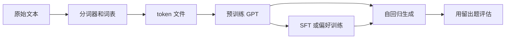

# 《从零开始制作 Deep Learning ⑥：LLM》中文学习路线

适合会编程、第一次学概率和神经网络的读者。第 1～9 章依据你提供的日文目录，第 0 章按出版社完整目录补齐。代码以本地官方仓库 `c9b6e2e` 为参照。每章讲义同时解释**当前问题为什么会出现、代码怎么解决、它为下游模型提供了什么**。

## 从一次真实运行开始

先进入本仓库根目录，运行下面这条命令。脚本使用官方分词器和 GPT，在本机 CPU 上训练一个极小模型，再重新加载模型并补全 Python 代码。

```bash
.venv/bin/python 小实验/codebot_cpu.py
```

先看损失下降、权重重新读取成功、补全文本出现。这个训练只给一条代码，因此学到的是对该例子的记忆。理解流程之后，再看第 3 章如何用一大批不同样本训练并检查泛化。环境来源、官方脚本、数据和权重路径见 [运行指南](运行指南.md)。

## 第 0～9 章地图

出版社完整目录包含第 0 章导论和第 1～9 章正文。你粘贴的版本从第 I 部开始，其中第 1～9 章合计 67 节、174 小节，另有 3 个部首导读、5 个附录和 6 篇专栏。每份讲义按原书节号定位，把较短的相邻小节放在一起解释。

| 章 | 学会的能力 | 带进下一步的产物 |
|---|---|---|
| [0 LLM 是怎样做出来的](ch00/学习讲义.md) | 用几行 Python 理解预测、生成和训练信号 | 能读懂后面九章共同的数据流 |
| [1 分词器](ch01/学习讲义.md) | 字符、UTF-8、BPE、特殊标记与压缩 | CodeBot 词表和 token 训练数据 |
| [2 模型](ch02/学习讲义.md) | 注意力、位置、因果遮罩和 GPT | 把 token IDs 变成下一 token 的分数 |
| [3 学习](ch03/学习讲义.md) | 预训练、采样、SFT 和 GRPO | 能补全、按指令答复、从反馈学习的 CodeBot |
| [4 分词器优化](ch04/学习讲义.md) | 去重、局部更新、分片、并行、磁盘映射 | 大语料的 BPE 工具与 StoryBot 语料 |
| [5 模型优化](ch05/学习讲义.md) | RoPE、SwiGLU、RMSNorm 和 KV 缓存 | 改良后的 GPT 和更省算力的生成 |
| [6 学习优化](ch06/学习讲义.md) | AdamW、学习率、混合精度、DPO 和评估 | 训练并改良 StoryBot |
| [7 WebBot 分词器](ch07/学习讲义.md) | 性能定位、原生加速与分词策略 | 面向大网页语料的 token 流 |
| [8 WebBot 模型](ch08/学习讲义.md) | 尺寸、FlashAttention、GQA、MoE 与长上下文 | 分析常见架构的内存与计算成本 |
| [9 WebBot 训练](ch09/学习讲义.md) | 梯度累积、并行、ZeRO、Muon、训练记录 | 能解释并复现扩展训练的基本流程 |

### 全书三次开发

1. **CodeBot** 从 TinyCodes 语料学会续写，再用指令对进行 SFT，最后用算术奖励演示在线采样学习。重点是确立训练闭环。
2. **StoryBot** 用 TinyStories 扩大数据处理规模，修改 Transformer 内部结构和训练策略，再用偏好对做 DPO。重点是稳定训练、评估与工程效率。
3. **WebBot** 面向更大网页语料，复用已验证的管线，把重点转到显存、吞吐和多设备。每个部件都应先能独立验证，再扩大规模。

## 贯穿全书的数据流



每次卡住，按箭头检查输入和输出。假如报索引越界，优先核对文件 dtype、词表 ID 和模型的词表大小。若输出结构混乱，检查提示模板、终止符以及模型是否加载了相应训练阶段的权重。若训练或生成太慢，再分开做数据、模型、硬件上的测量。

## 程序员入门数学

- **向量**是一组特征数。点积对应“相同位置相乘后求和”。矩阵乘法是成批做点积。
- **形状**是记在变量旁的契约。`[B,T,D]` 里 B 是样本数，T 是序列长度，D 是每个位置的特征宽度。
- **logits** 是可正可负的分数。softmax 把分数变为概率，数值实现通常先减最大值。负对数概率惩罚模型给正确结果的低概率。
- **损失**是对误差的一个标量度量。**梯度**表示参数改变一点时损失怎样动。`backward()` 算梯度，`step()` 更新参数。损失函数、优化器和采样解的是三个不同问题。
- **参数**在训练时更新。**输入状态**如 KV 缓存随请求变化。**超参数**如学习率、上下文长度由你设定。
- **日志和验证集**用来检验变化是否真的有益。举例说，损失降低、输出可读、回答正确是三个不同的指标。

## 原书附录与专栏怎样读

| 附录 | 现在需要的直觉 | 配合章节 |
|---|---|---|
| A UTF-8 | 多字节序列的首字节指示长度，后续字节承载编码位 | 1、4、7 |
| B 注意力缩放 | 独立项求和，方差相加，标准差按平方根增长 | 2 |
| C 基线 | 若基线与当前动作无关，乘以策略得分函数后的期望为 0。组内含自己的均值要另外讨论估计偏差 | 3 |
| D Adam 偏差修正 | 从零开始的指数平均少了早期权重，除以累计权重 `1−β^t` | 6 |
| E DPO | 带参考 KL 约束的最优策略会按奖励指数重加权参考策略，偏好对取差消掉同一提示下的归一化项 | 6 |

BPE 平局、注意力逐行计算、序列概率、GRPO 变体、分词内存和 BF16 的专栏问题分别串在各章。第一次先运行实验，第二次用附录补证明，最后试着只看输入和输出把主流程写出来。

## 回到原始资料

[日本 O’Reilly 书页](https://www.oreilly.co.jp/books/9784814401611/) · [官方代码](https://github.com/oreilly-japan/deep-learning-from-scratch-6) · [作者数据卡](https://huggingface.co/datasets/koki0702/zero-llm-data)。仓库 README 指向的勘误页本次检索跳回仓库首页。若遇到疑似错误，可以同时核查本地脚本和[仓库讨论](https://github.com/oreilly-japan/deep-learning-from-scratch-6/issues)。


想选一门公开课程对照，可从斯坦福 CS336 的分词、架构和系统课程中，按正在读的章节选一个主题。每章末尾的论文和文档标出了具体要比较的概念，适合做完该章实验后再读。[Stanford CS336](https://cs336.stanford.edu/)
